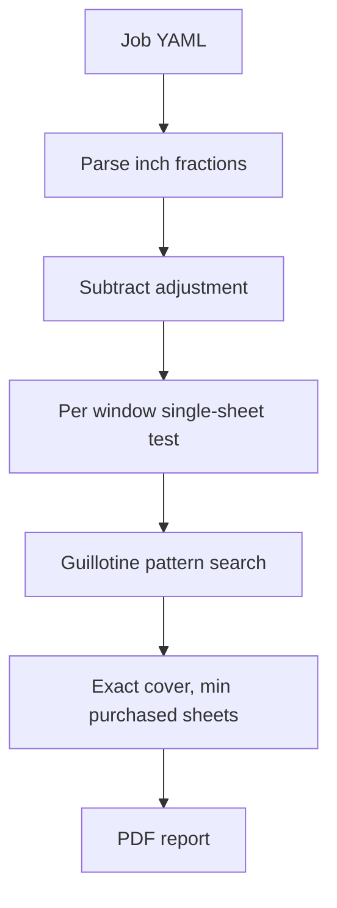

# Glass cutting planner

## What this job actually needs

Rough sizes are reduced by the YAML `adjustment`, which for this job is **1/8" on width and on height** (one-eighth total per dimension, not per edge). Every pane in this file is **1/8"** thick, and it is cut only from 1/8" stock. Pieces may be rotated. Clear glass has no grain. Kerf defaults to 0 and stays configurable.

Every score runs the **full width or the full length** of the piece in hand. It does not stop partway across the glass. A strip snapped off as waste is at least **3"** (`min_leverage` in the YAML), so there is glass to grip and lever. A flush edge, where the pane already meets the edge of the piece, needs no snap. Among layouts that obey that, the cut order leaves the **largest residual rectangle**, and that residual is freed by the first score on the whole sheet.

For the two panes of a small window, such as LRE upper and lower, the order is fixed:

1. Score the **top edge across the whole stock width**, and snap off the residual.
2. On the remaining piece, score the **division between the two panes from edge to edge**, the full width of that piece. This separates the panes so each length can be cut on its own strip.
3. Cut each pane's length separately, on its own strip.

After that deduction, nothing shares a sheet except the two panes of a small window:

- Each LRM, DRM, and DRS pane is about 36–38" by 28". It fits on 36×44 only with the long side along 44". The leftover strip is about 6–8" (DRS leaves a 16 1/8" strip if the 35 7/8" side is put along 36", which is still short of the narrowest small pane at 16 5/8"). One large pane per sheet, and the two panes of a large window do **not** fit together.
- Each LRW, DRW, LRE, and DRE pair is about 17" by 28". Both panes still fit on one sheet, but not in a band that leaves a strip under 3" to snap. A third pane does not fit. The same-sheet rule therefore puts exactly one small window on each of those sheets, and it does not add sheets beyond the geometric minimum.

**Result the program must produce for this job: 10 sheets of 36×44×1/8. On hand: 5. Purchase: 5.** Waste is whatever remains on those 10 sheets, since every pane is cut and every sheet is the same size. The 3" snap rule changes how a sheet is arranged, not how many sheets are needed. A large pane still cannot leave a 1/8" sliver on the 36" side, because that strip cannot be snapped. A small window's two panes cannot sit side by side along the 36" side, because the leftover there is about 2 1/2" to 2 3/4". They are placed so every snapped strip is at least 3", and the first cut leaves the largest remnant.

Cut sizes the tests will lock in:

- LRM upper 37 5/8 × 28 3/16; lower 37 5/8 × 27 7/8
- DRM upper 37 11/16 × 28 1/4; lower 37 11/16 × 27 7/8
- DRS upper 35 7/8 × 28; lower 35 7/8 × 27 7/8
- LRW upper 16 3/4 × 28 1/4; lower 16 5/8 × 27 3/4
- DRW upper 16 3/4 × 28 3/16; lower 16 3/4 × 27 7/8
- LRE upper 16 5/8 × 28 1/4; lower 16 3/4 × 27 3/4
- DRE upper 16 5/8 × 28 3/8; lower 16 5/8 × 27 3/4

## Program

Python 3.12.8, the interpreter already installed. Create the venv with that executable (`py -3.12`) and run the CLI and tests from the venv. `requires-python` is `>=3.12,<3.13`. Runtime dependencies are `PyYAML` for the job file and `reportlab` for the PDF. Shop file in, PDF report out. The console prints the same purchase count and waste total so a run can be checked without opening the file.



The only job input is [data/windows.yaml](data/windows.yaml), loaded with `yaml.safe_load`. It holds the adjustment, the pane thickness, the stock list, and the windows. For this job the adjustment is `1/8` and the thickness is `1/8` for every pane. A pane may set its own `thickness`; otherwise it uses the top-level value. A pane is cut only from stock of the same thickness.

```yaml
adjustment: 1/8
thickness: 1/8
stock:
  - width: 36
    height: 44
    thickness: 1/8
    on_hand: 5
windows:
  - id: LRM
    panes:
      - name: upper
        width: 37 3/4
        height: 28 5/16
      - name: lower
        width: 37 3/4
        height: 28
```

`adjustment` is subtracted from each pane’s width and from its height (one-eighth total per dimension, not per edge). Stock entries are purchasable unless `purchasable: false`. The file lists all seven windows and 5 sheets of 36×44×1/8.

Inch parser in [glasscut/units.py](glasscut/units.py) accepts `37 3/4`, `37-3/4`, `3/4`, and decimals that land on a sixteenth. All math uses `fractions.Fraction`. Display is mixed numbers to the sixteenth. A pane that fits on no sheet, or whose thickness matches no stock, is an error that names the pane. The PDF summary repeats the adjustment and thickness taken from the file.

## Solver

[glasscut/pack.py](glasscut/pack.py) — exact guillotine packer for one rectangle and a small set of panes (this job never places more than two). It returns a binary cut tree, not just coordinates:

- Place one pane at the origin of the current rectangle, either orientation.
- Split the remainder with one through-cut the full width or full length of that piece: vertical at the pane’s width, or horizontal at the pane’s height.
- Reject a split whose waste strip is thinner than 3". A zero-width edge, where the pane already fills that side, is allowed.
- Recurse, trying which remaining panes go to which residual rectangle.
- Keep the tree whose largest residual rectangle is biggest.
- Memoize on rectangle size plus the set of panes still to place.

The tree is the cut sequence. Before it is reported, parallel through-cuts are reordered so a waste strip that still spans the full stock width is snapped off the whole sheet first. On a two-pane sheet the next score is the division between the panes, edge to edge across that piece, and only then is each pane's length cut on its own strip.

[glasscut/optimize.py](glasscut/optimize.py):

- A window is **atomic** when all of its panes pack onto one empty sheet of some listed size. Atomic panes may appear only as a full set. LRM, DRM, and DRS are not atomic on 36×44; the four small windows are.
- Enumerate candidate subsets (atomic windows count as one item, so this job is 4 groups + 6 loose panes). Drop a subset when its area, either side, or a failed pack says it does not fit. Reject subsets that contain only part of an atomic window.
- Exact cover over those patterns: every pane once, minimize sheets purchased, then total sheets, then prefer the layout whose largest residual rectangle is bigger. On-hand sheets of a size are free up to `on_hand`; further sheets of a purchasable size cost one. Identical sheets are not distinct bins, which avoids searching the same packing five times.
- If a single pane exceeds every sheet, stop and name it. Pattern search is exact while each sheet holds at most 8 panes, which covers window glass. Above that, stop with a clear message instead of guessing.

## PDF report

`python -m glasscut data/windows.yaml -o out`

[glasscut/report.py](glasscut/report.py) writes [out/cut-plan.pdf](out/cut-plan.pdf) (letter size) and prints two lines to the console: sheets to buy, and total waste. Drawings are vector rectangles in the PDF, to the same scale on both axes, converted from fractions only at draw time. No separate SVG files.

The PDF has three parts:

1. **Summary.** Adjustment and pane thickness as read from the YAML (`1/8` and `1/8` for this job). Input stock by size and thickness (5 sheets of 36×44×1/8 on hand). Sheets required, sheets taken from that stock, and sheets to buy (10 required, 5 purchased). Every window is listed as completed or not, with its panes and the sheet numbers those panes are cut from. This job completes all seven windows. Waste is the offcut area: square inches, square feet, percent of the glass used, and the waste on each sheet.

2. **Pane schedule.** The section states the adjustment amount (`1/8"` for this job): cut size subtracts that amount from width and from height. One row per pane, grouped by window: thickness, rough opening, cut size after that adjustment, and which sheet it is on.

3. **One page per sheet used in the cut, including sheets that must be purchased.** Ten pages for this job. Each page is one physical piece of stock:
   - Heading with sheet number, size, thickness, and whether it comes from on-hand stock or is a purchase
   - A to-scale drawing of that sheet showing each pane placed for cutting, labeled with window, pane name, and cut size, plus hatched offcuts labeled with their sizes
   - Sheet outline dimensions, and the ordered score list (distance from a named edge, across the current piece)
   - Waste from that sheet

Pages for a window’s sheets stay together, so LRM’s two sheets are consecutive, then DRM, DRS, and each small window.

Usage lives in `--help` and the module docstring. No README.

## Tests

[tests/test_job.py](tests/test_job.py) with pytest:

- Fraction parse and the 14 cut sizes above
- LRM’s two panes do not share a 36×44 sheet; LRW’s do
- Full job: 10 sheets, 5 purchased, each small window alone on one sheet, each large pane alone on one sheet
- Every placed rectangle is inside the sheet, matches the cut size up to rotation, and does not overlap
- A pane larger than every sheet fails with that pane’s name
- The PDF has a summary, a pane schedule, and one drawing page per sheet (12 pages). Extracted text includes every window id, the 5 sheets to buy, and the waste total

Run `python -m pytest` and `python -m glasscut data/windows.yaml -o out` with the 3.12.8 venv. Automated checks use `pypdf` (test dependency only) for page count and text, and assert the PDF text includes the `1/8` adjustment, the `1/8` thickness, and that same adjustment amount in the pane schedule. Then open [out/cut-plan.pdf](out/cut-plan.pdf) and confirm the summary, the pane schedule, and that each of the 10 sheet pages shows that sheet’s layout. This is a CLI plus a PDF, not a web UI.
